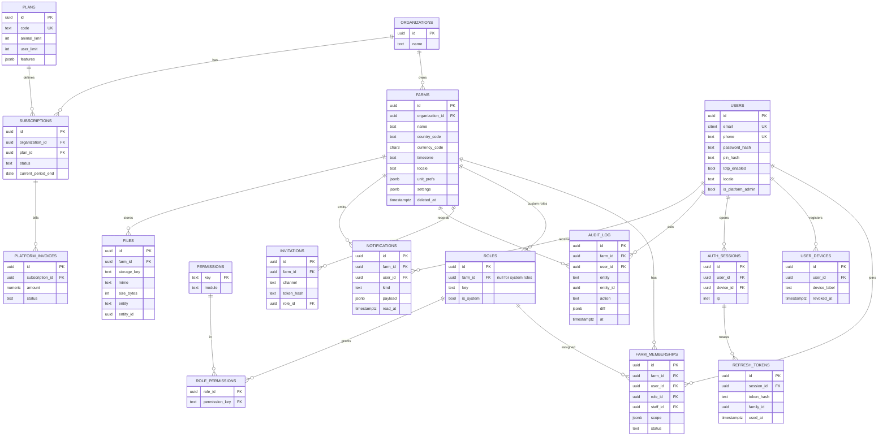
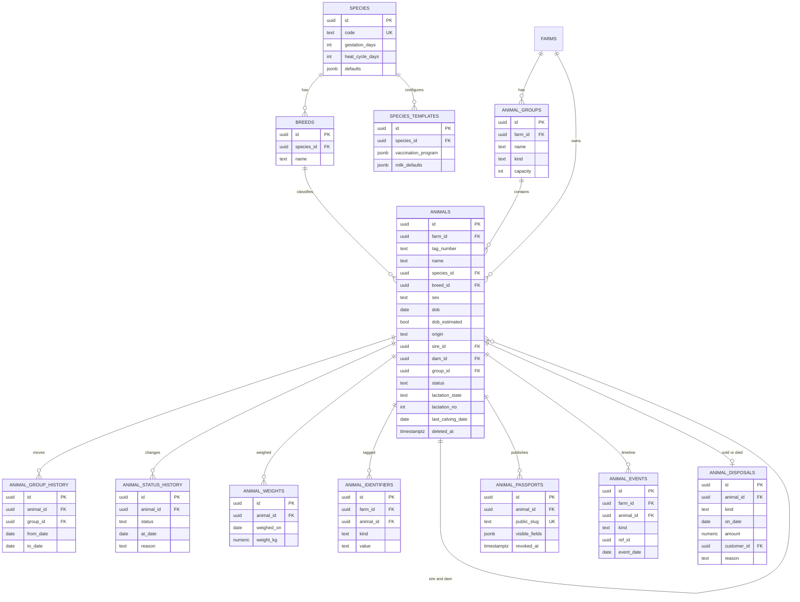
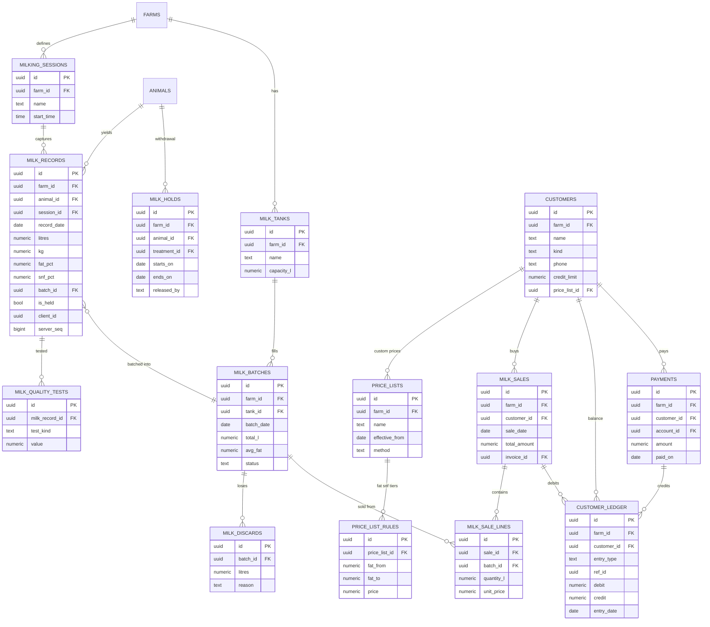
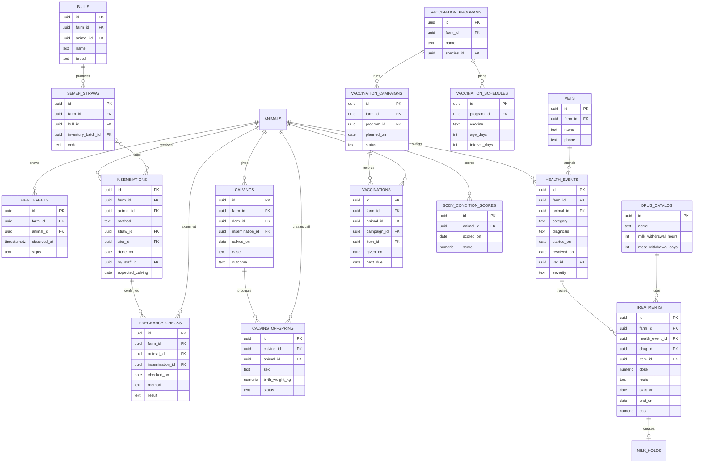
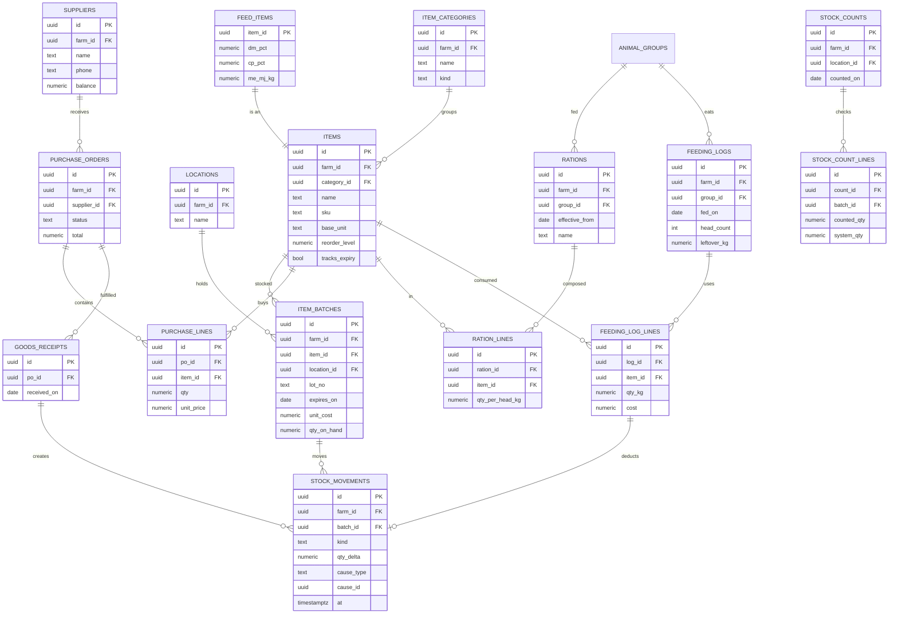
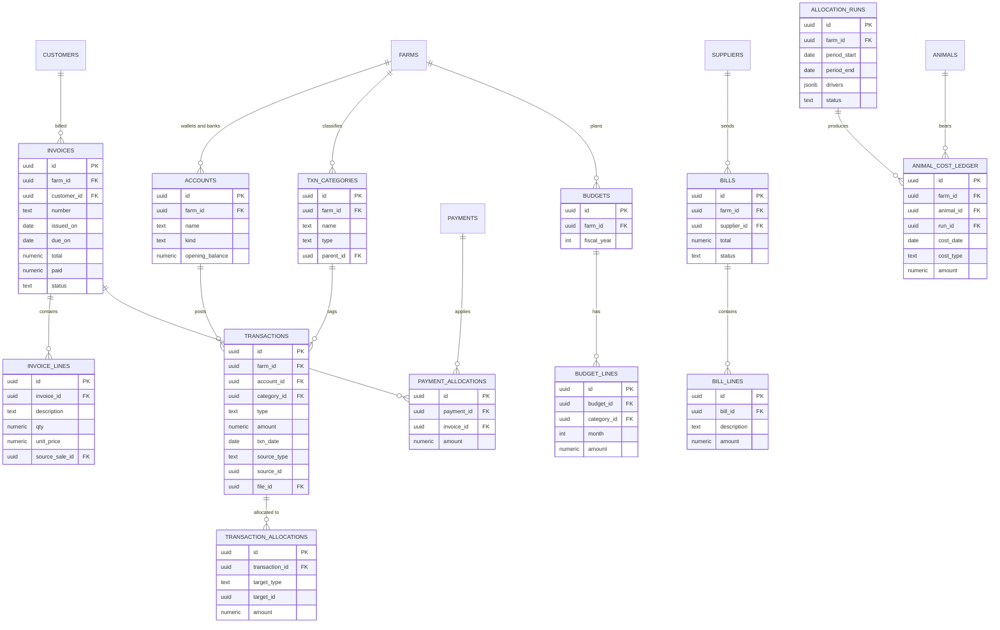
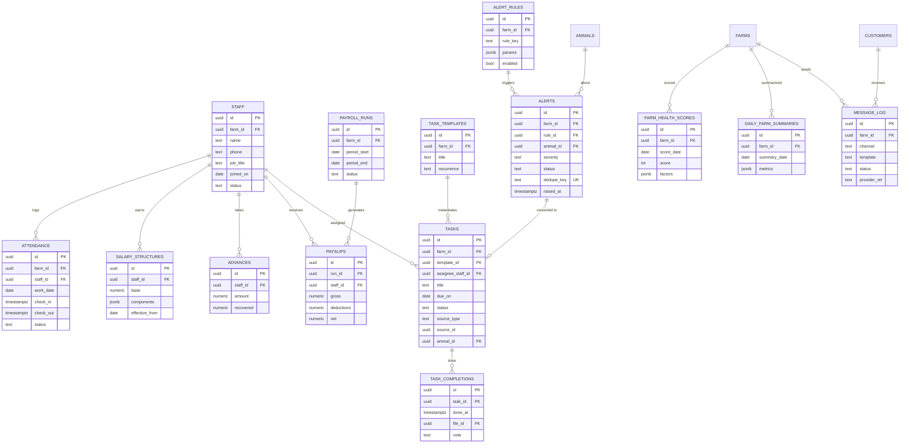

# Database Design and ERD

PostgreSQL 16+. Diagrams are Mermaid (render in GitHub, VS Code, or any Mermaid viewer). Diagrams show keys and the columns that matter for relations and queries; the full column lists are defined in `packages/db/src/schema/*` during implementation and must follow the conventions below.

## 1. Global conventions

| Rule | Detail |
|---|---|
| Primary keys | `uuid` UUIDv7 (time-ordered, index friendly, client-generatable for offline) |
| Tenancy | `farm_id uuid not null` on every business table + RLS policy. Exceptions: global reference tables (`species`, `breeds`, `drug_catalog`, `plans`, `permissions`) and platform tables |
| Audit columns | `created_at`, `updated_at`, `created_by`, `updated_by`, `version int` (optimistic lock) |
| Soft delete | `deleted_at timestamptz null`; unique indexes are partial `WHERE deleted_at IS NULL` |
| Money | `numeric(14,2)`; currency stored on the farm, and on each foreign-currency document with `exchange_rate numeric(18,8)` |
| Quantities | `numeric(12,3)`, canonical units (L, kg, C, m) |
| Enums | Postgres enums for closed sets that change rarely; lookup tables for farm-configurable sets (e.g. expense categories) |
| Naming | snake_case, plural table names, FK = `<entity>_id` |
| Sync | Offline-writable tables also carry `client_id uuid`, `client_created_at`, `server_seq bigint` (identity, for pull) and `needs_review boolean` |
| Constraints | CHECK constraints for domain limits (e.g. `litres between 0 and 80`), FK with explicit ON DELETE (RESTRICT by default), composite FKs `(farm_id, id)` to prevent cross-tenant references |
| Cross-tenant safety | Child tables reference parents with composite FK `(farm_id, parent_id) -> parent(farm_id, id)` so a row can never point into another farm |

## 2. Identity, tenancy, access

Notes
- `audit_log` is monthly-partitioned and append-only (no UPDATE/DELETE grants).
- Seeded system roles: owner, manager, veterinarian, accountant, supervisor, worker, driver, readonly. Custom roles clone a system role.
- `farm_memberships.scope` holds row-scope rules (e.g. group ids a worker may see).

## 3. Herd

Notes
- `ANIMALS` unique: `(farm_id, tag_number) WHERE deleted_at IS NULL`; identifiers unique on `(farm_id, kind, value)`.
- `animals.lactation_state`, `lactation_no`, `last_calving_date` are denormalized and maintained by domain logic for fast list filters; the events remain the truth.
- `animal_events` is a lightweight timeline index (kind + ref to the source row) powering the animal profile feed without 8-way unions.
- Pedigree queries use a recursive CTE on `sire_id/dam_id` limited to 5 generations.

## 4. Milk and sales

Notes
- `milk_records` unique `(farm_id, animal_id, record_date, session_id) WHERE deleted_at IS NULL` prevents duplicate entry (offline duplicates become `needs_review`).
- `customer_ledger` is append-only; balance = sum(debit - credit); a cached `customers.balance` is updated in the same transaction and reconciled nightly.
- Reconciliation invariant: sum(milk_records.litres) = batched + discarded + home use + unbatched.

## 5. Breeding and health

## 6. Feed, inventory, purchasing

Notes
- `stock_movements` is append-only; `item_batches.qty_on_hand` is a cached sum updated in the same transaction (CHECK >= 0 unless farm setting allows negative).
- Costing uses FEFO issue order with batch `unit_cost` (weighted-average option per farm).
- `treatments.item_id` and `vaccinations.item_id` deduct stock through `stock_movements` with `cause_type`/`cause_id`.

## 7. Finance

Notes
- Simple farm-friendly model (cash-basis transactions plus receivables/payables) with an optional accountant view; no free-form journal editing in v1. Totals reconcile with `customer_ledger` and `bills`.
- Invoices are immutable once issued; corrections use credit notes (status `void` + new invoice).
- `animal_cost_ledger` rows are generated per period by an `allocation_run` and are replaceable (delete+insert in one transaction per run) so re-running allocation is safe.

## 8. People and tasks

## 9. Rollups (read models)

Maintained by worker; never written by API request paths.

| Table / view | Grain | Used by |
|---|---|---|
| `mv_milk_daily` | farm, date, session, group | dashboards, trends |
| `mv_animal_lactation` | animal, lactation_no | lactation curves, 305-day projection |
| `mv_herd_snapshot_daily` | farm, date, status | herd composition trend |
| `mv_repro_kpis_monthly` | farm, month | reproduction dashboard |
| `mv_cost_per_litre_daily` | farm, date, group | cost per liter |
| `mv_receivables_aging` | farm, customer | finance dashboard |
| `animal_profit_monthly` | animal, month | profit-per-animal ranking |

## 10. Index plan (initial; verified with EXPLAIN on seeded data)

| Table | Index | Serves |
|---|---|---|
| animals | `(farm_id, status, group_id)`, partial unique `(farm_id, tag_number)`, trigram GIN on `name, tag_number`, `(farm_id, dam_id)`, `(farm_id, sire_id)` | lists, search, pedigree |
| milk_records | PK; `(farm_id, record_date, session_id)`, `(farm_id, animal_id, record_date desc)`, partial unique dedupe key, BRIN `(record_date)`, `(farm_id, server_seq)` | daily entry, per-animal curve, sync pull |
| milk_holds | partial `(farm_id, animal_id) WHERE released_at IS NULL`, `(farm_id, ends_on)` | active hold lookup on every milk write |
| customer_ledger | `(farm_id, customer_id, entry_date, id)` | statements |
| stock_movements | `(farm_id, batch_id, at)`, `(farm_id, cause_type, cause_id)` | stock history, traceability |
| item_batches | `(farm_id, item_id, expires_on)` partial `qty_on_hand > 0` | FEFO issue |
| transactions | `(farm_id, txn_date, category_id)`, `(farm_id, account_id, txn_date)` | P&L, cash book |
| tasks | `(farm_id, assignee_staff_id, status, due_on)` | my tasks |
| alerts | unique `dedupe_key`, `(farm_id, status, severity, raised_at desc)` | alert inbox, idempotent jobs |
| audit_log | BRIN `(at)`, `(farm_id, entity, entity_id, at desc)` | history view |
| all offline tables | `(farm_id, server_seq)` | sync pull |

Rules: every FK column is indexed; no index without a named query; review unused indexes quarterly via `pg_stat_user_indexes`.

## 11. Partitioning and retention

- Range-partition by month: `milk_records`, `feeding_log_lines`, `audit_log`, `message_log`, `stock_movements`, `customer_ledger`. A worker job pre-creates partitions 3 months ahead.
- Retention: business data kept for the life of the account; `message_log` 13 months, `audit_log` 7 years (archived to cold storage after 24 months), refresh tokens purged on expiry.
- Farm deletion: 90-day grace, then cascaded purge job with a verification report.
